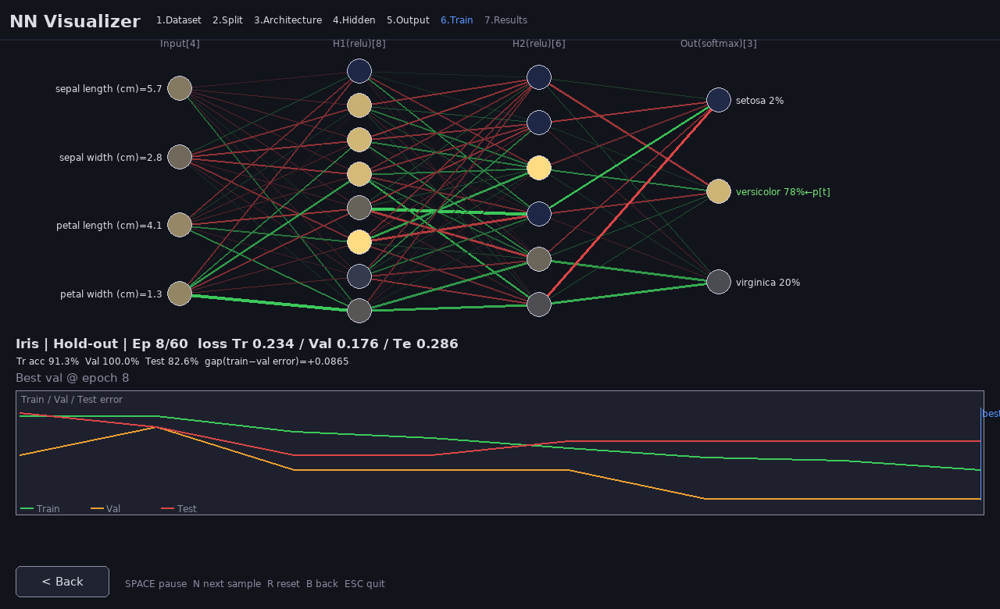
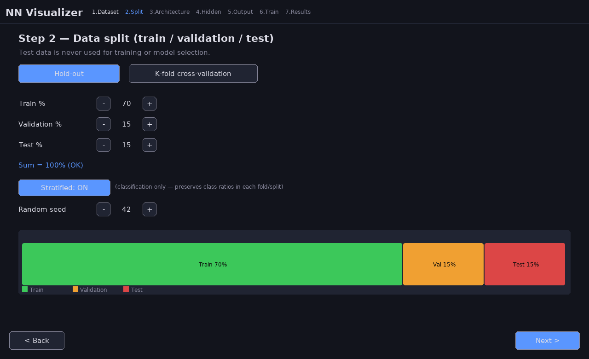
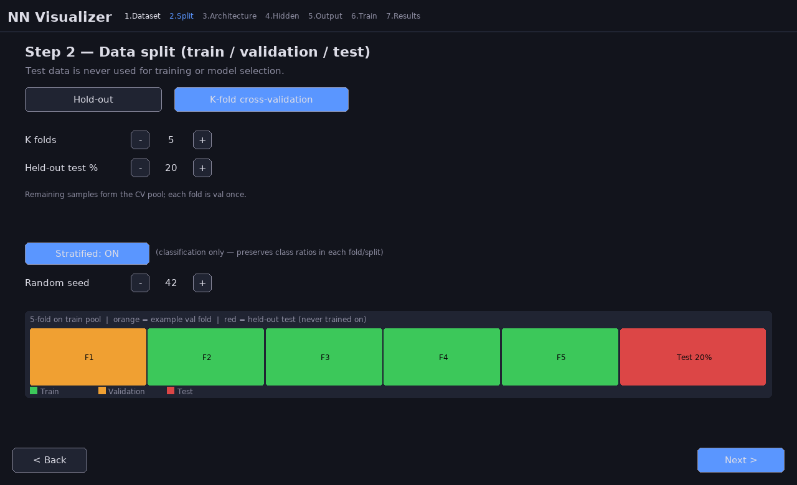
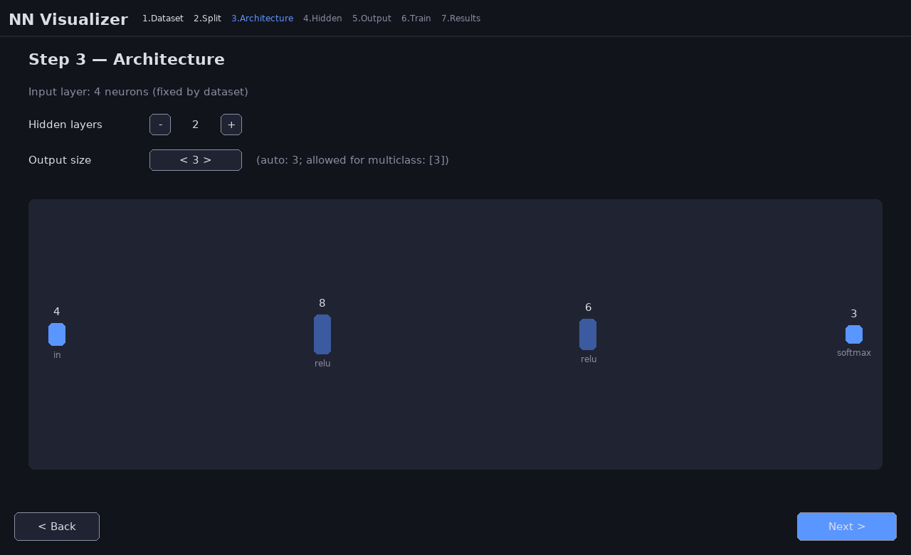
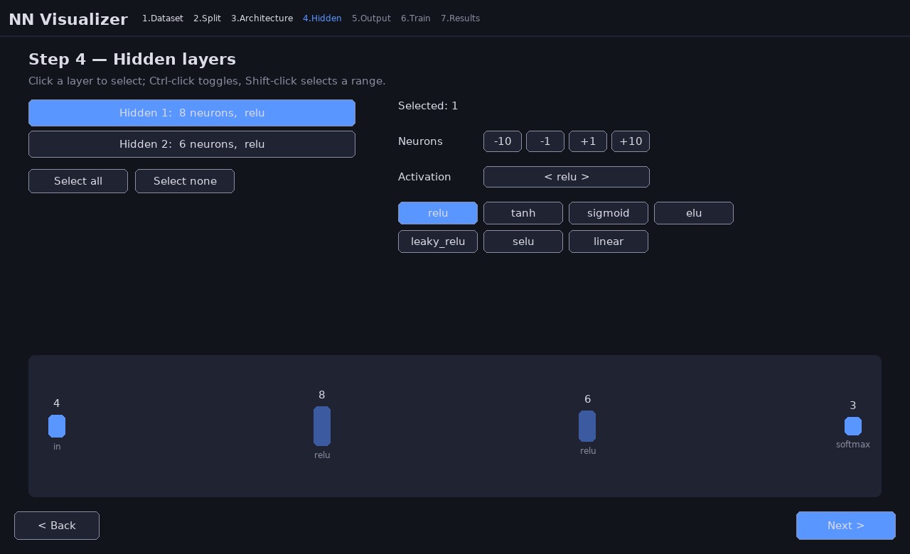
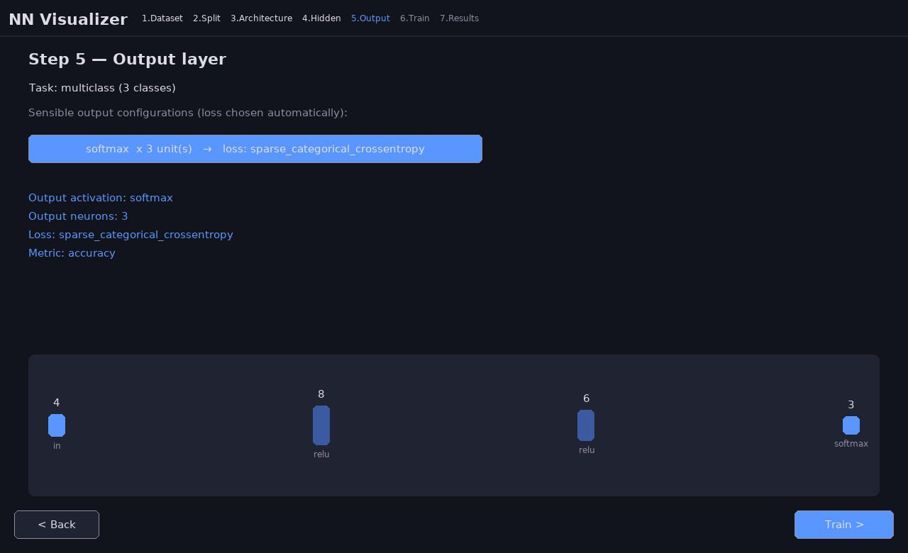
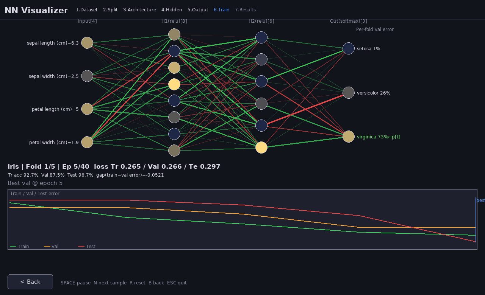
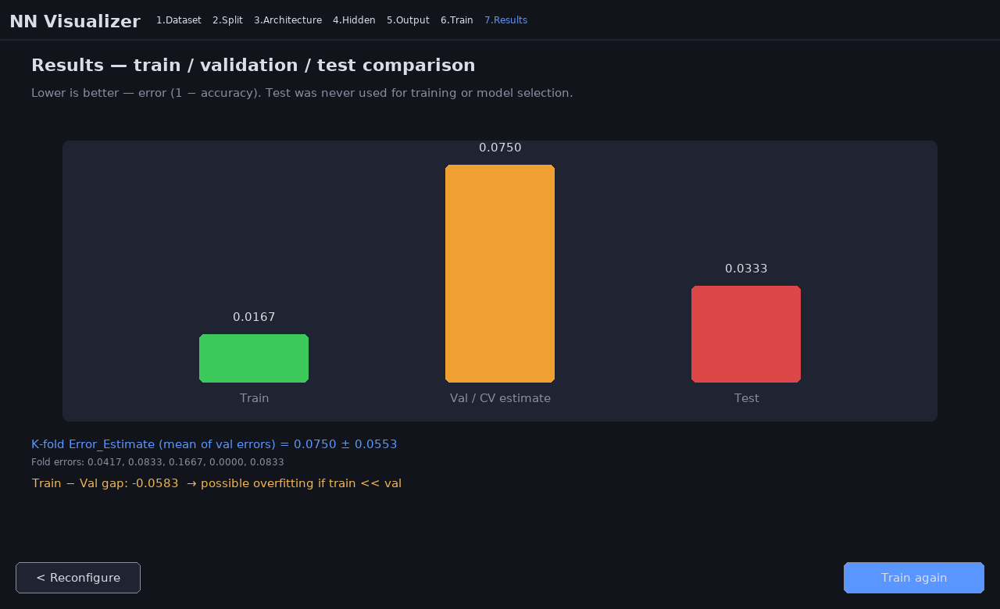
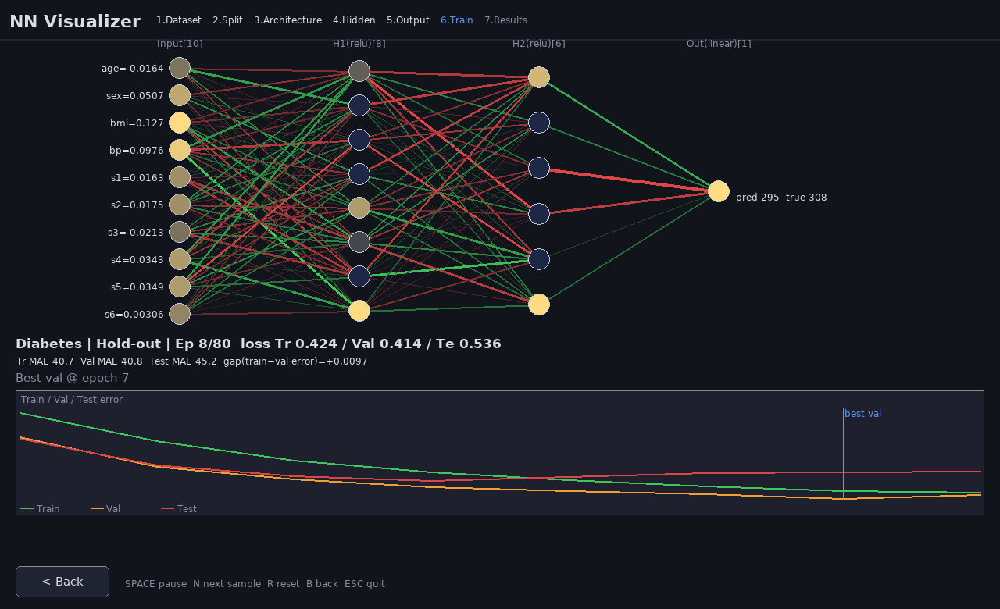
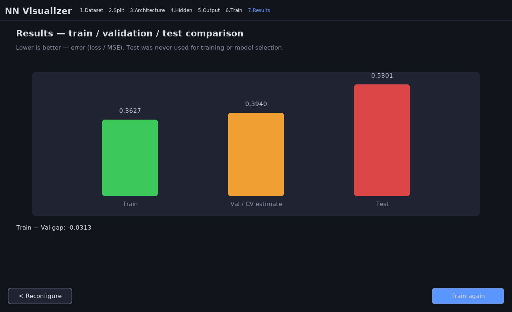

# Neural Network Visualization

A Pygame desktop app that walks you through a configuration wizard, then trains a
`tf.keras` network on a public dataset while drawing **every layer live**.

It follows the usual ML lecture pipeline: **train / validation / test** splits,
optional **K-fold (stratified) cross-validation**, live **train vs val vs test**
error curves, an overfitting hint, and a final comparison of the three errors.
The held-out **test set is never used for training or model selection**.



## Wizard

| Step | What you choose |
|------|-----------------|
| 1. Dataset | Iris, Wine, Breast Cancer, Digits, Diabetes, or California Housing (sklearn → pandas). Input size and task type are detected automatically. |
| 2. Split | **Hold-out** (train/val/test %, must sum to 100, test > 0) or **K-fold CV** (K, held-out test %, Stratified toggle for classification, random seed). Colored bar diagram: green = train, orange = val, red = test. |
| 3. Architecture | Number of hidden layers (0–8) and output size (constrained by task). |
| 4. Hidden | Neuron count and activation per layer. Ctrl/Shift multi-select; edits apply to the selection. |
| 5. Output | Only sensible activations (`softmax` / `sigmoid` / `linear`) with auto loss. |
| 6. Train | Live activations/weights, train/val/test curves, best-val epoch, overfitting warning. K-fold trains fold-by-fold then retrains on all train data. |
| 7. Results | Bar chart comparing final train / val (or CV Error_Estimate) / test error. |








### Data split (lecture-style)

- **Hold-out:** percentages for train / validation / test (e.g. 70/15/15). Validation is used to pick the best epoch; test is display-only until the Results screen.
- **K-fold CV:** a held-out test % is removed first; the remaining pool is split into K folds (optionally **stratified**). Each fold is validation once.  
  `Error_Estimate = mean(val errors)` (± std). Then a **final model** is retrained on the whole train pool and evaluated on the untouched test set.
- **Stratified** preserves class ratios (classification only).






## Run

```bash
python3 -m venv .venv
source .venv/bin/activate
pip install -r requirements.txt
python nn_visualizer.py
```

### CLI flags

| Flag | Meaning |
|------|---------|
| `--dataset NAME` | Start dataset (default Iris) |
| `--epochs N` | Max epochs per train phase (default 300) |
| `--split holdout\|kfold` | Split mode (default holdout) |
| `--train-pct / --val-pct / --test-pct` | Hold-out percentages (default 70/15/15) |
| `--k N` | Number of folds (default 5) |
| `--test-pct-kfold N` | Held-out test % for K-fold (default 20) |
| `--stratified` / `--no-stratified` | Stratified splits (default on; ignored for regression) |
| `--seed N` | Shuffle seed (default 42) |
| `--auto` | Scripted demo: walk wizard, train, save screenshots, exit |
| `--seconds N` | Soft training-time budget in `--auto` |
| `--screenshot-dir DIR` | PNG output dir for `--auto` (default `screenshots`) |

Headless checks:

```bash
SDL_VIDEODRIVER=dummy python nn_visualizer.py --auto --dataset Iris --split holdout --epochs 80
SDL_VIDEODRIVER=dummy python nn_visualizer.py --auto --dataset Iris --split kfold --k 5 --stratified --epochs 40
SDL_VIDEODRIVER=dummy python nn_visualizer.py --auto --dataset Diabetes --split holdout --no-stratified --epochs 80
```

## Controls (Train step)

| Key / UI | Action |
|----------|--------|
| Space | Pause / resume |
| N | Next validation sample |
| R | Reset training |
| B / Back | Return to Output step |
| Esc | Quit |

Lines: green = positive weight, red = negative, thicker = larger `|w|`.  
Curves: green train, orange validation, red test (test for display only).  
Neuron brightness = activation for the current validation sample.
