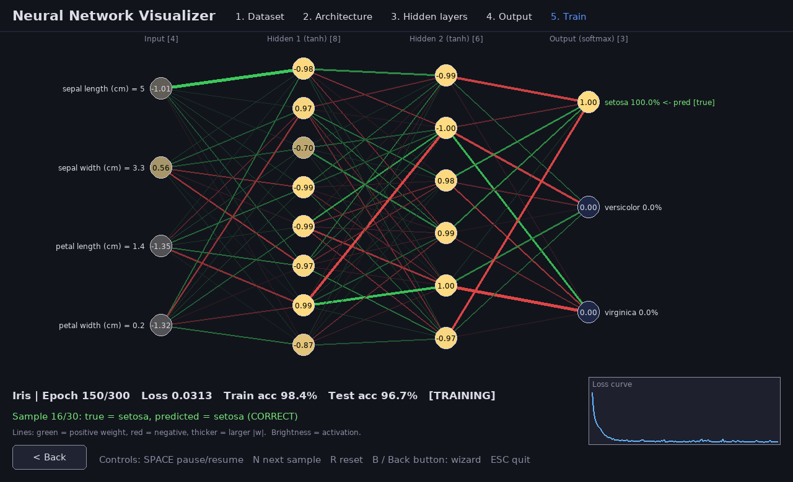
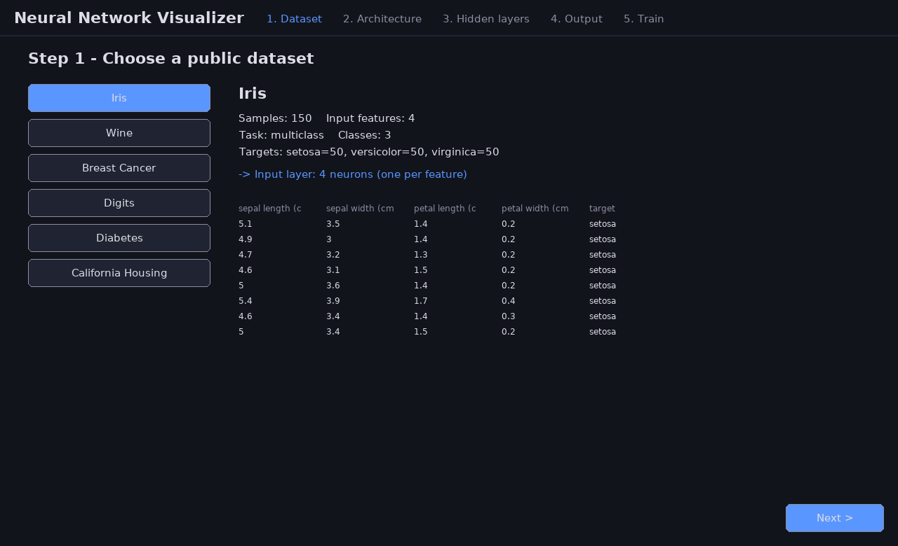
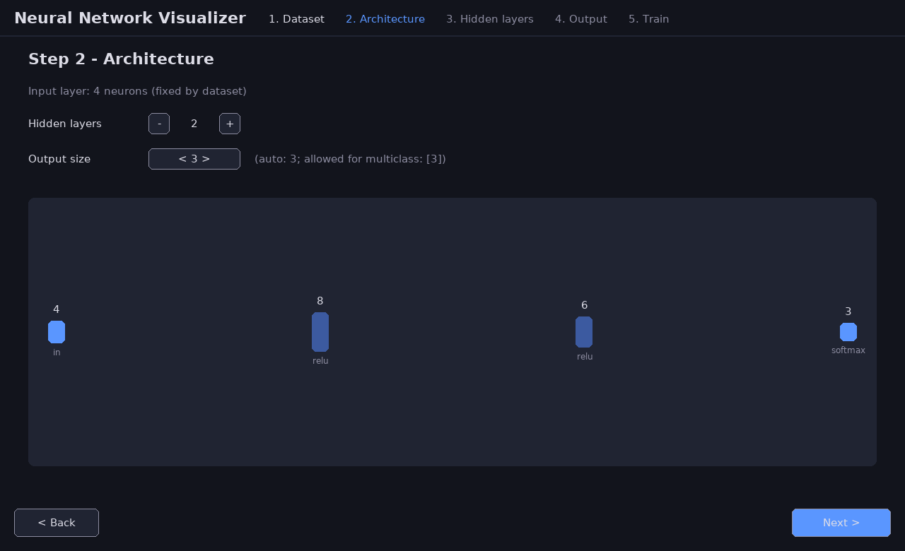
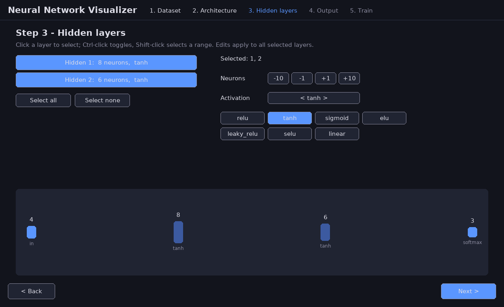
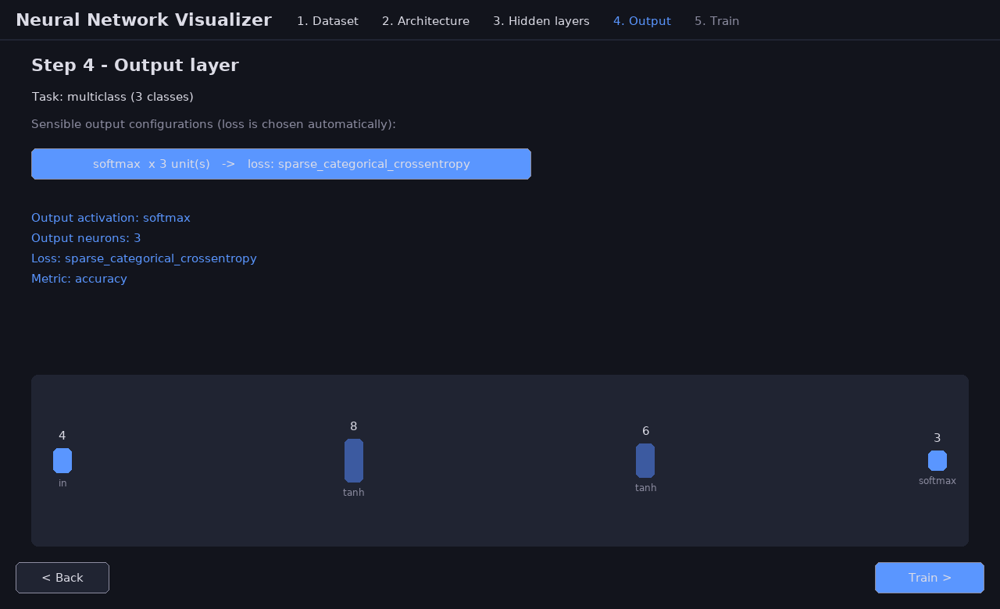
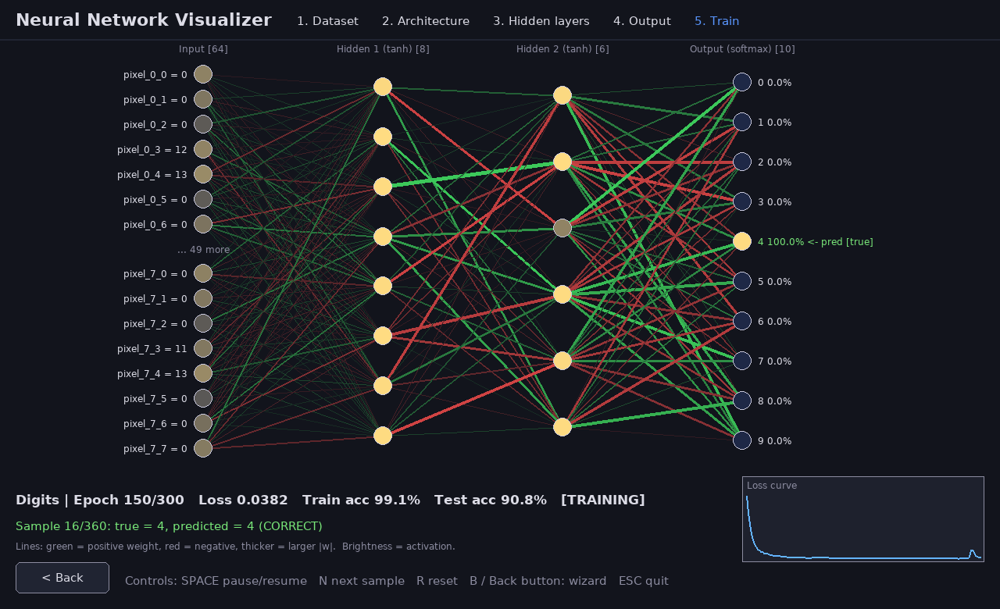
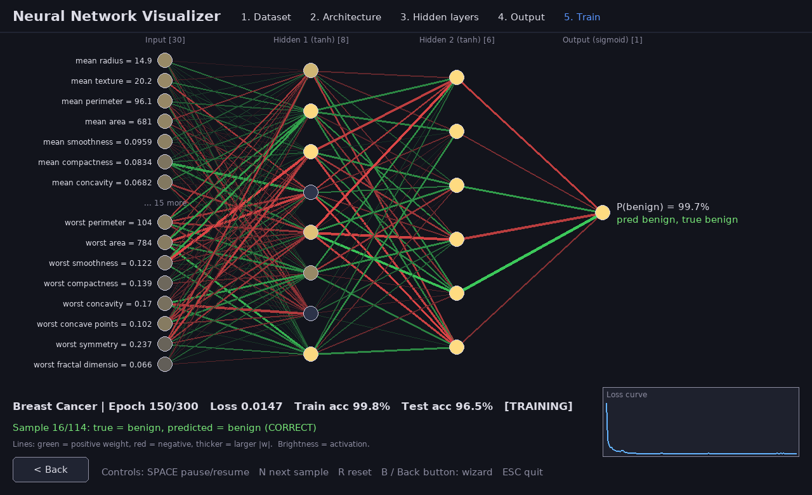
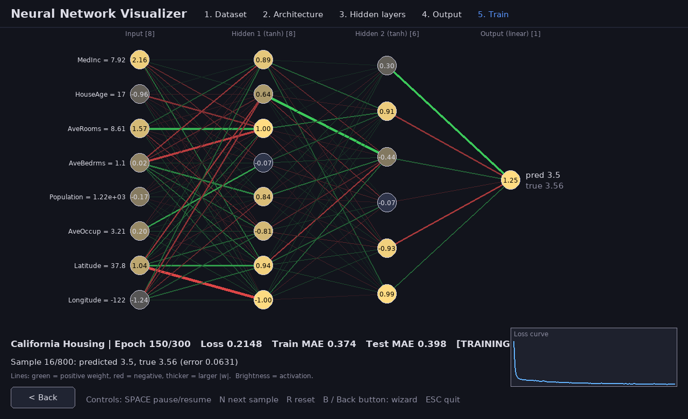

# Neural Network Visualization

A Pygame desktop app that walks you through a short configuration wizard, then trains a
`tf.keras` neural network on a public dataset while drawing **every layer live**.



## Wizard

| Step | What you choose |
|------|-----------------|
| 1. Dataset | Iris, Wine, Breast Cancer, Digits, Diabetes, or California Housing (sklearn → pandas). Input size and task type are detected automatically; a preview table is shown. |
| 2. Architecture | Number of hidden layers (0–8) and output size (constrained to what the task allows). |
| 3. Hidden layers | Neuron count and activation (`relu`, `tanh`, `sigmoid`, `elu`, `leaky_relu`, `selu`, `linear`) per layer. Ctrl-click toggles, Shift-click selects a range, **Select all** / **none**; edits apply to the selection. |
| 4. Output | Only sensible activations: `softmax` for multi-class, `sigmoid` or 2-way `softmax` for binary, `linear` for regression. Matching loss is chosen automatically (sparse categorical / binary crossentropy / MSE). |
| 5. Train | Live visualization of activations and weights. |






Large layers (e.g. Digits with 64 inputs) are drawn compactly with an ellipsis for the middle neurons.
Regression runs show MAE instead of accuracy.





## Run

```bash
python3 -m venv .venv
source .venv/bin/activate        # Windows: .venv\Scripts\activate
pip install -r requirements.txt
python nn_visualizer.py
```

Options:

| Flag | Meaning |
|------|---------|
| `--dataset NAME` | Start with this dataset (default Iris) |
| `--epochs N` | Max training epochs (default 300) |
| `--auto` | Scripted demo: walk the wizard with defaults, train, save screenshots, exit |
| `--seconds N` | Training time in `--auto` mode (default 8) |
| `--screenshot-dir DIR` | Where `--auto` writes PNG files (default `screenshots`) |

Headless check:

```bash
SDL_VIDEODRIVER=dummy python nn_visualizer.py --auto --dataset Digits --seconds 6
```

## Controls (Train step)

| Key / UI | Action |
|----------|--------|
| Space | Pause / resume |
| N | Next test sample |
| R | Reset (rebuild & retrain) |
| B / Back | Return to the Output wizard step |
| Esc | Quit |

Lines: green = positive weight, red = negative, thicker = larger `|w|`. Neuron brightness = activation for the current sample.
