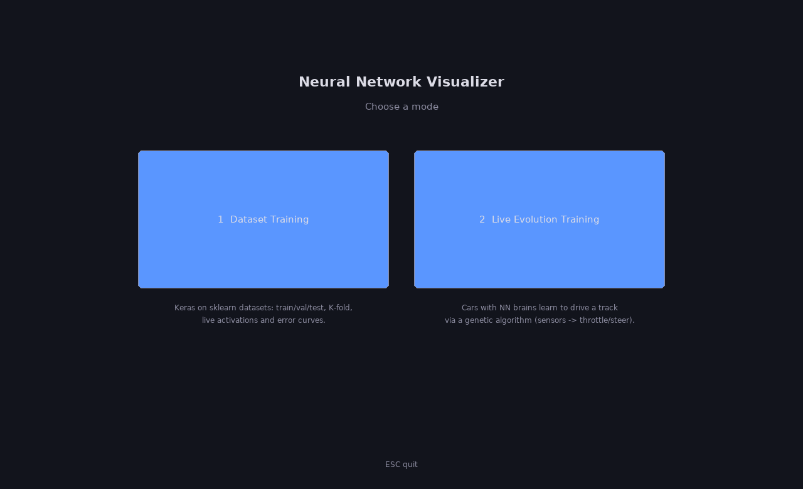
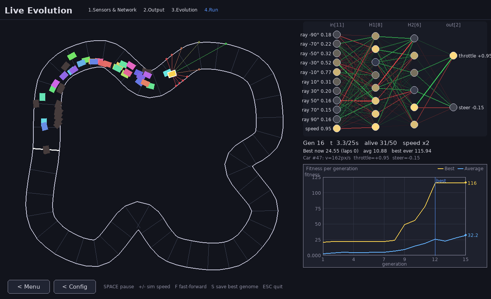
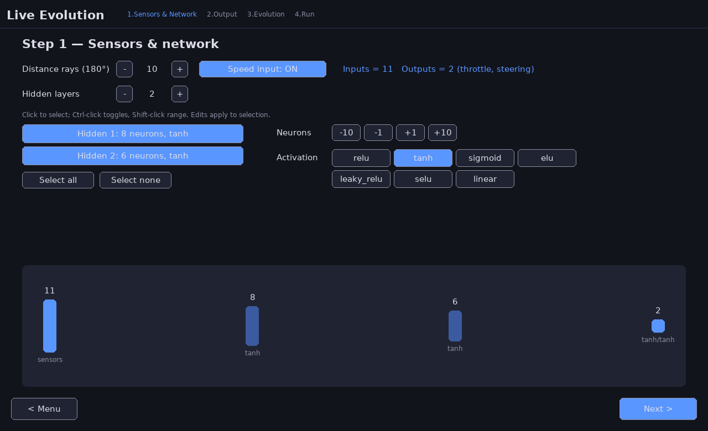
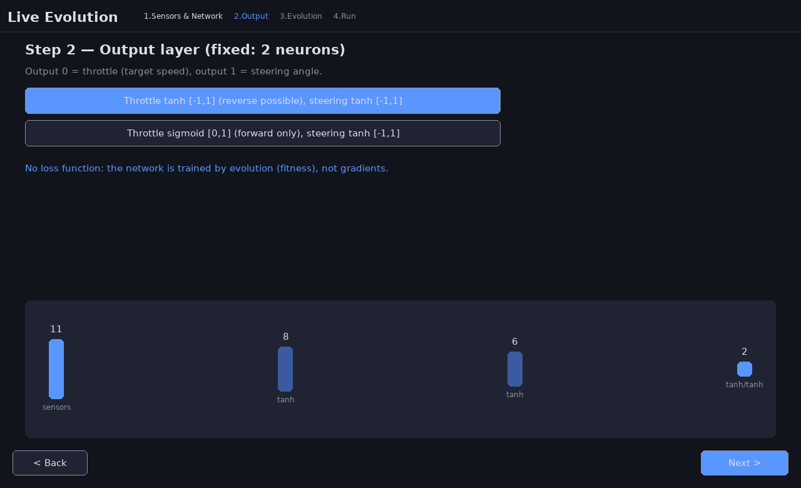
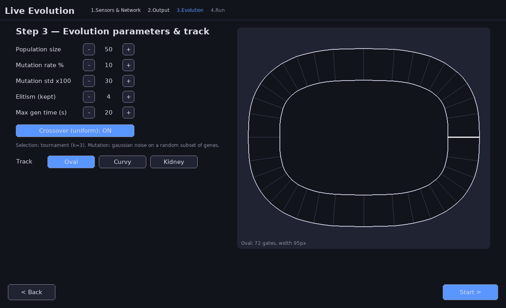
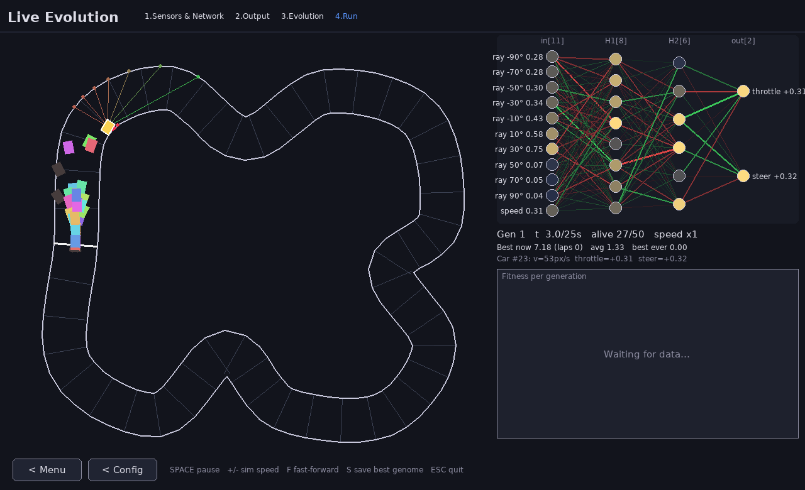
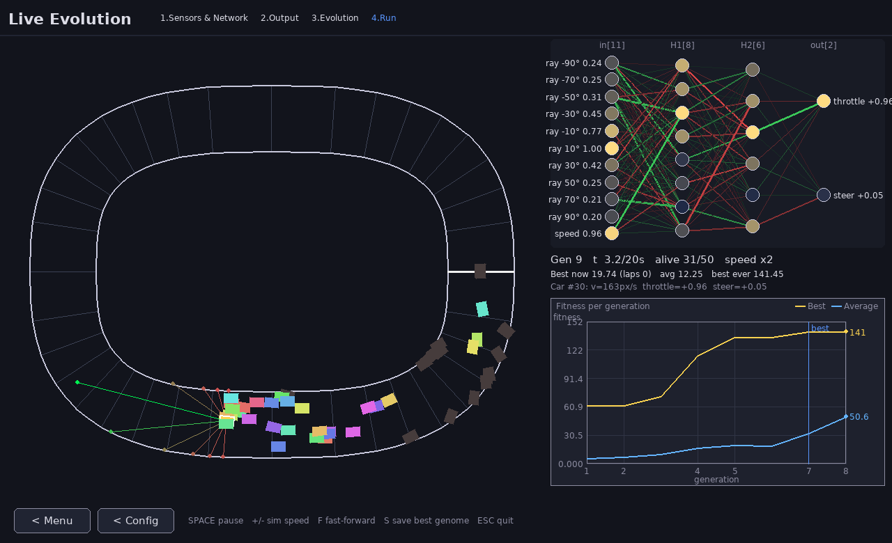

# Neural Network Visualization

A Pygame desktop app with two modes, chosen on the start screen:

1. **Dataset Training** – configure and train a `tf.keras` network on a public dataset
   (train/val/test, K-fold CV), visualizing every layer live.
2. **Live Evolution Training** – a population of cars with neural-network brains learns to
   drive a track via a **genetic algorithm**; the best car's network is drawn live.



# Mode 1 — Dataset Training


## Wizard

| Step | What you choose |
|------|-----------------|
| 1. Dataset | Iris, Wine, Breast Cancer, Digits, Diabetes, or California Housing (sklearn → pandas). Input size and task type are detected automatically. |
| 2. Split | **Hold-out** (train/val/test %, must sum to 100, test > 0) or **K-fold CV** (K, held-out test %, Stratified toggle for classification, random seed). Colored bar diagram: green = train, orange = val, red = test. |
| 3. Architecture | Number of hidden layers (0–8) and output size (constrained by task). |
| 4. Hidden | Neuron count and activation per layer. Ctrl/Shift multi-select; edits apply to the selection. |
| 5. Output | Only sensible activations (`softmax` / `sigmoid` / `linear`) with auto loss. |
| 6. Train | Live activations/weights, train/val/test curves, best-val epoch, overfitting warning. K-fold trains fold-by-fold then retrains on all train data. |
| 7. Results | Bar chart comparing final train / val (or CV Error_Estimate) / test error. |


### Data split (lecture-style)

- **Hold-out:** percentages for train / validation / test (e.g. 70/15/15). Validation is used to pick the best epoch; test is display-only until the Results screen.
- **K-fold CV:** a held-out test % is removed first; the remaining pool is split into K folds (optionally **stratified**). Each fold is validation once.  
  `Error_Estimate = mean(val errors)` (± std). Then a **final model** is retrained on the whole train pool and evaluated on the untouched test set.
- **Stratified** preserves class ratios (classification only).
- **Show test curve (didactic, peeking)** is **OFF by default**. During training only Train and Val (or fold-val) are plotted; test is evaluated **once** on the final model at the Results screen. Enabling the toggle peeks at test during training — not proper practice.
- Error plot: grid, axis ticks/titles, end-value labels, last-value readout; press **L** for log scale.


## Run

```bash
python3 -m venv .venv
source .venv/bin/activate
pip install -r requirements.txt
python nn_visualizer.py
```

### CLI flags

| Flag | Meaning |
|------|---------|
| `--dataset NAME` | Start dataset (default Iris) |
| `--epochs N` | Max epochs per train phase (default 300) |
| `--split holdout\|kfold` | Split mode (default holdout) |
| `--train-pct / --val-pct / --test-pct` | Hold-out percentages (default 70/15/15) |
| `--k N` | Number of folds (default 5) |
| `--test-pct-kfold N` | Held-out test % for K-fold (default 20) |
| `--stratified` / `--no-stratified` | Stratified splits (default on; ignored for regression) |
| `--seed N` | Shuffle seed (default 42) |
| `--show-test-curve` | Didactic: plot test during training (default off) |
| `--auto` | Scripted demo: walk wizard, train, save screenshots, exit |
| `--seconds N` | Soft training-time budget in `--auto` |
| `--screenshot-dir DIR` | PNG output dir for `--auto` (default `screenshots`) |

Headless checks:

```bash
SDL_VIDEODRIVER=dummy python nn_visualizer.py --auto --dataset Iris --split holdout --epochs 80
SDL_VIDEODRIVER=dummy python nn_visualizer.py --auto --dataset Iris --split kfold --k 5 --stratified --epochs 40
SDL_VIDEODRIVER=dummy python nn_visualizer.py --auto --dataset Diabetes --split holdout --no-stratified --epochs 80
```

## Controls (Train step)

| Key / UI | Action |
|----------|--------|
| Space | Pause / resume |
| N | Next validation sample |
| R | Reset training |
| B / Back | Return to Output step |
| L | Toggle log / linear y-scale on the error plot |
| Esc | Quit |

Lines: green = positive weight, red = negative, thicker = larger `|w|`.  
Curves: green train, orange validation, red test (test for display only).  
Neuron brightness = activation for the current validation sample.

# Mode 2 — Live Evolution Training



### Wizard
| Step | What you choose |
|------|-----------------|
| 1. Sensors & Network | Number of distance rays spread over 180° in front of the car (default 10), optional speed input, hidden layer count, per-layer/group neuron count + activation (same group-select editor as dataset mode). |
| 2. Output | Fixed 2 outputs: **throttle** and **steering**. `tanh/tanh` (default, throttle in [-1,1] with weak reverse) or `sigmoid` throttle (forward only) + `tanh` steering. |
| 3. Evolution | Population (default 50), mutation rate %, mutation std, elitism, uniform crossover on/off, max generation time, track (**Oval**, **Curvy**, **Kidney**) with preview. |
| 4. Run | Live simulation. |





### How it works
- **Tracks** (`evolution/tracks.py`): hand-made closed centerlines; inner/outer wall polylines are offsets (tiny loops at tight bends are removed). Gates (checkpoints) span inner→outer at each centerline point.
- **Car physics** (`evolution/sim.py`): heading/bicycle model, throttle sets target speed with limited acceleration, steering turns proportional to speed. Fully vectorized over the population with numpy.
- **Sensors:** ray casting against all wall segments → normalized distances in [0,1].
- **Death:** wall collision, no gate progress for 3.5 s (stuck/too slow), or crossing the last gate backwards.
- **Fitness:** gates passed (laps count) + fraction toward next gate + small average-speed bonus.
- **Brain** (`evolution/brain.py`): numpy forward pass for the whole population at once. Genome = flattened weights in Keras `get_weights()` order (`W1,b1,W2,b2,…`, kernels shaped `(in, out)`).
- **GA** (`evolution/ga.py`): tournament selection (k=3), elitism, uniform crossover, gaussian mutation. A new generation starts when all cars are dead or the time limit is hit.
- **Rendering:** all cars (best = yellow with white outline, dead = faded), sensor rays of the best car, live network diagram of the best alive car (sensor inputs, hidden activations, throttle/steer) and a best/average fitness-per-generation plot with grid and numeric axes (`render.py`, shared helpers).




### Controls (Run)
| Key / UI | Action |
|----------|--------|
| Space | Pause / resume |
| + / - | Simulation speed (1, 2, 4, 8, 16 steps per frame) |
| F | Fast-forward (cars not rendered, max steps per frame) |
| S | Save best genome to `best_genome.npz` |
| B / Menu button | Back to start menu |
| Config button | Back to evolution parameters |
| Esc | Quit |

### Evolution CLI flags
| Flag | Meaning |
|------|---------|
| `--mode menu\|dataset\|evolution` | Start screen (default) or jump directly into a mode |
| `--track Oval\|Curvy\|Kidney` | Track (default Oval) |
| `--population N` | Population size (default 50) |
| `--gen-time S` | Max seconds per generation (default 20) |
| `--generations N` | Generations to run in `--auto` (default 8) |
| `--auto-target dataset\|evolution` | With `--auto` and `--mode menu`: mode entered after the menu screenshot |

Headless:
```bash
SDL_VIDEODRIVER=dummy python nn_visualizer.py --auto --auto-target evolution --track Oval --generations 8
SDL_VIDEODRIVER=dummy python nn_visualizer.py --mode evolution --auto --track Curvy --generations 15 --gen-time 25
```

## Project layout
```
nn_visualizer.py     start menu + dataset-mode wizard/training
datasets.py          dataset loading, hold-out / K-fold splits
widgets.py           self-drawn Pygame widgets
render.py            shared network diagram + line chart
evolution/
  tracks.py  sim.py  brain.py  ga.py  app.py
```

## Tests

`tests/test_interactive.py` drives the **interactive** code paths headlessly (no `--auto`) by feeding
synthetic mouse/key events into the real handlers: menu → evolution wizard → running simulation
(speed, pause, fast-forward, save), evolution → back to menu, and menu → dataset wizard → training.

```bash
SDL_VIDEODRIVER=dummy python tests/test_interactive.py     # or: python -m pytest tests
```
