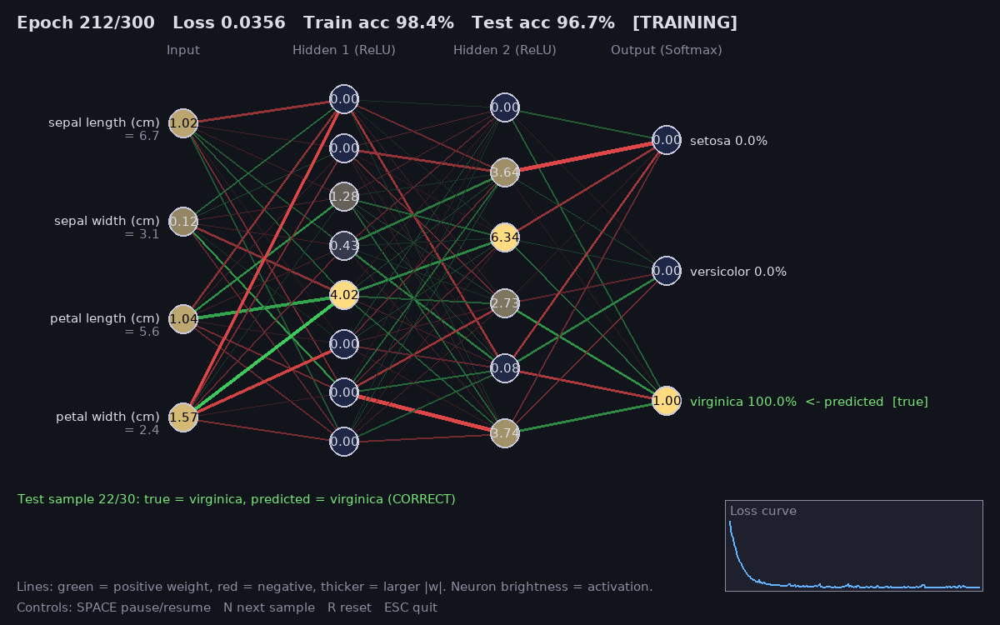

# Neural Network Visualization

A small desktop app that trains a `tf.keras` neural network on the Iris dataset
(loaded via scikit-learn into a pandas DataFrame) and visualizes the **whole network live** in Pygame.

- Architecture: 4 inputs -> Dense 8 (ReLU) -> Dense 6 (ReLU) -> Dense 3 (Softmax)
- Neuron brightness = current activation for the displayed test sample
- Connection lines: green = positive weight, red = negative, thicker = larger magnitude
- Input neurons show feature names and raw values; output neurons show class probabilities, predicted vs. true class
- Header shows epoch, loss, train/test accuracy; bottom-right shows a live loss curve
- Training runs one epoch per frame (`train_on_batch`), so the GUI stays responsive



## Run

```bash
python3 -m venv .venv
source .venv/bin/activate        # Windows: .venv\Scripts\activate
pip install -r requirements.txt
python nn_visualizer.py
```

Options: `--epochs 300`, `--seconds N` (auto-quit), `--screenshot out.png` (save window on exit).

Headless test: `SDL_VIDEODRIVER=dummy python nn_visualizer.py --seconds 8 --screenshot screenshot.png`

## Controls

| Key   | Action            |
|-------|-------------------|
| Space | Pause / resume    |
| N     | Next test sample  |
| R     | Reset (new model) |
| Esc   | Quit              |
